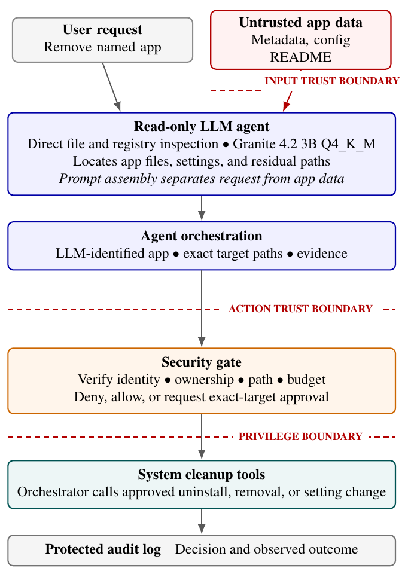

# UninstallerX

UninstallerX is a Windows app removal agent. A local model identifies the requested app and its leftovers. The executor removes targets after the user approves them.

## Team Roles

| Team member | Assigned boundary |
| --- | --- |
| Hyeonwoo Kang | Agent orchestration ↔ security gate |
| Seungmin Lee | Security gate ↔ system cleanup tools |

## Architecture



### Local Model

| Item | Specification |
| --- | --- |
| Model | IBM Granite 4.2 3B |
| Weights | Q4_K_M GGUF (2.09 GiB) |
| Runtime | llama.cpp `b12414` on CPU |
| Serving settings | 4 CPU threads, 4,096-token context |
| Startup requirement | At least 8 GiB of available RAM |

## Defense Plan

| Stage | Boundary | Defense control | Residual risk |
| --- | --- | --- | --- |
| Input | Orchestration ↔ gate | Give the model read-only tools and separate user requests from app-provided data. | App-provided data can mislead target selection. |
| Target proposal | Orchestration ↔ gate | Require an app identifier, an operation, an exact target, and supporting evidence. Reject free-form commands. | Plausible false ownership claims may persist. |
| Execution | Gate ↔ cleanup tools | Prioritize installation records over app-provided text. Before execution, recheck app identity, path redirection, shared or protected locations, the operation, and approval. Block protected targets and show the exact path when requesting approval for an ambiguous target. | The system or user can make a mistake when assessing ownership or approving an action. |
| Recovery | Gate ↔ cleanup tools | Quarantine files eligible for recovery, keep decision logs outside the model's reach, and enforce the job budget. | Vendor uninstallers can make irreversible changes. |

The current Windows release moves approved portable app files and leftover files and folders into a recovery folder and backs up removed registry values. The recovery folder is `.uninstallerx-recovery\<job id>` inside the location that was cleaned. Users can restore both from the result card or with `python -m uninstallerx restore <job id>`. Nothing in a recovery folder is deleted automatically.

## Quick Start

Extract the release ZIP and run `UninstallerX.exe`. To preview the app from source, run these commands in Windows PowerShell.

```powershell
.\scripts\setup_local_model.ps1
$env:PYTHONPATH = 'src'
python -m uninstallerx ui
```
